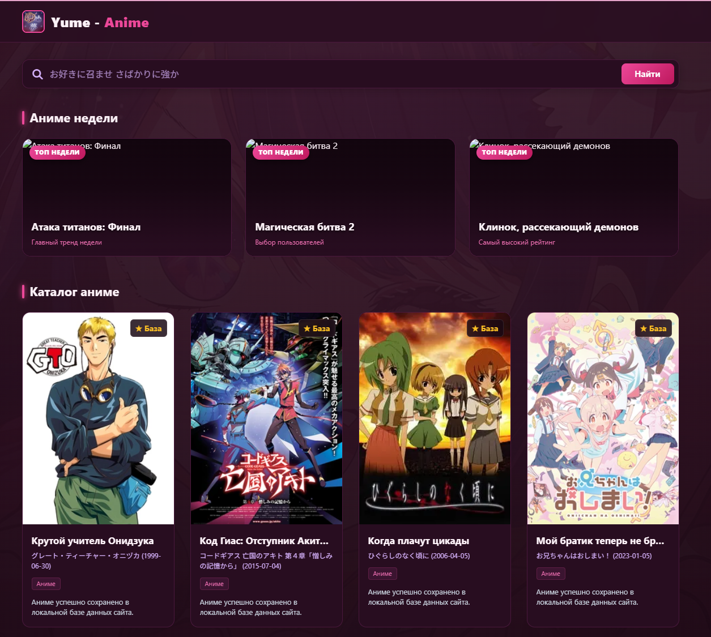

# 🌸 Yume-Anime | Fullstack Anime Catalog

## 🚀 О проекте

**Yume-Anime** — это веб-приложение для поиска и каталогизации аниме. Главная особенность проекта заключается в реализации архитектурного паттерна **Cache-Aside**: система не нагружает внешние сервисы лишними запросами, хранит уже найденные тайтлы в собственной базе данных и автоматически подтягивает новые данные «на лету», если пользователь ищет что-то уникальное.

---



## 🛠 Технологический стек

* **Backend:** Python 3.14, FastAPI, `uvicorn`, `httpx` (асинхронные запросы)
* **Database & Driver:** PostgreSQL, `psycopg` (безопасные параметризованные SQL-запросы, транзакции)
* **External API:** Shikimori GraphQL API (интеграция с переменными и обработкой постеров)
* **Frontend:** HTML5, CSS3 (CSS Grid, Flexbox, Custom CSS Variables, Adaptive Media Queries), Vanilla JavaScript (AJAX / Fetch API)
* **DevOps:** Docker, Docker Compose, Nginx, Adminer

---

## 🧠 Архитектурная фича: Паттерн Cache-Aside

1. **Локальный поиск:** При запросове пользователя бэкенд сначала ищет совпадения в локальной базе PostgreSQL (`ILIKE` по русским, оригинальным и японским названиям).
2. **Внешний fallback:** Если в базе данных тайтла нет, система обращается к официальному **Shikimori GraphQL API**.
3. **Автосохранение:** Полученные данные автоматически валидируются, сохраняются в PostgreSQL с защитой от дубликатов (`ON CONFLICT (shikimori_id) DO NOTHING`), после чего возвращаются клиенту.
4. **Быстрый доступ:** Повторный запрос выдает результат из локальной базы за миллисекунды.

## ✨ Основные возможности

* 🔍 **Интеллектуальный поиск:** Мгновенный поиск по базе с автоматическим расширением каталога из Shikimori.
* 🎲 **Случайный каталог:** Эндпоинт `/api/random` с сортировкой `ORDER BY RANDOM()`, подгружающий случайные карточки из базы при старте сайта.
* 📅 **Секция «Аниме недели»:** Адаптивные баннеры в формате 16:9 с уникальным дизайном.
* 📱 **Адаптивный UI/UX:**
* Каталог: 4 колонки на ПК / 2 колонки на мобильных устройствах.
* Аниме недели: 3 колонки на ПК / 1 колонка на мобильных устройствах.


* 🎨 **Уникальная стилизация:** Темно-розовая неоновая палитра, полупрозрачные плашки (`backdrop-filter: blur`), кастомные SVG/CSS маски и случайные фоны.


## ⚙️ Быстрый запуск через Docker

Проект полностью контейнеризирован: сайт, API, база данных и Adminer поднимаются одной командой.

### Требования

- [Docker](https://docs.docker.com/get-docker/) с плагином Docker Compose

### 1. Клонируйте репозиторий

```bash
git clone https://github.com/aquwiriwivi-eng/anime_site_von_Vmsk_Wivi.git
cd anime_site_von_Vmsk_Wivi
```

### 2. Создайте файлы окружения

В проекте два файла с настройками: для базы данных (`.env.db`) и для API (`.env.api`). Рядом лежат шаблоны `*.example`:

```bash
cp .env.db.example .env.db
cp .env.api.example .env.api
```

Откройте созданные файлы и впишите **свои** значения.

**`.env.db`**: доступы к PostgreSQL

```env
POSTGRES_USER=ваш_пользователь
POSTGRES_PASSWORD=ваш_надёжный_пароль
POSTGRES_DB=ваша_база
```

**`.env.api`**: пароль, с которым API подключается к базе

```env
DB_PASSWORD=ваш_надёжный_пароль
```

> ⚠️ Пароль в `DB_PASSWORD` должен совпадать с `POSTGRES_PASSWORD`.

> 💡 Если файлы `.env.db` и `.env.api` не создавать, будут использованы значения по умолчанию из `.env.db.example` и `.env.api.example` (пароль `PASS123`). Подходит для локальной проверки, но **не для сервера**.

### 3. Запустите проект

```bash
docker compose up -d
```

Первый запуск соберёт образ API, это займёт пару минут. После изменений в коде бэкенда используйте `docker compose up -d --build`.

### 4. Готово 🎉

| Сервис | Адрес |
|---|---|
| 🌸 Сайт | http://localhost (или IP вашего сервера) |
| 🗄 Adminer (управление БД) | http://localhost:8051 |

Для входа в Adminer выберите систему **PostgreSQL**, сервер `postgre_sql` и укажите данные из

## 👨‍💻 Автор

С любовью от **Vmsk_Wivi** 🌸
=======
