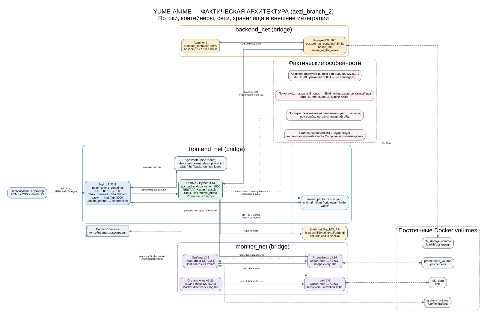
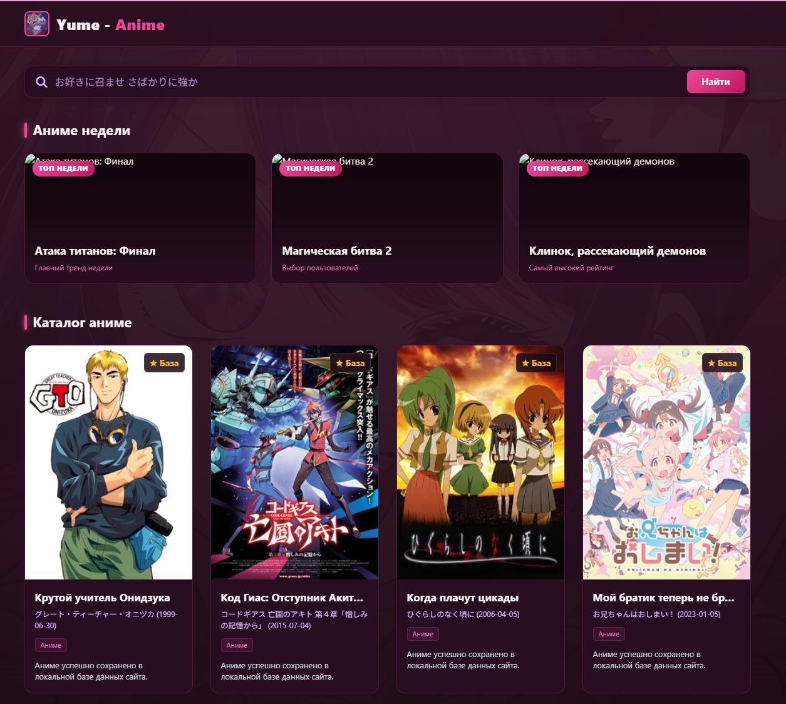

# 🌸 Yume-Anime

[](https://www.python.org/)
[](https://fastapi.tiangolo.com/)
[](https://www.postgresql.org/)
[](https://www.docker.com/)
[](https://grafana.com/)

**Современный аниме-каталог с русскоязычным интерфейсом, интеллектуальным поиском через Shikimori GraphQL API, админ-панелью для «Аниме недели» и production-grade стеком мониторинга (Prometheus + Grafana + Loki + Grafana Alloy).**

## 📌 О проекте

**Yume-Anime** — это веб-приложение для поиска и просмотра каталога аниме, спроектированное по микросервисной архитектуре в Docker. Особенность проекта — комбинированный поиск **Local-First + External-Sync**: система мгновенно выдаёт результаты из локальной базы PostgreSQL и параллельно обращается к внешнему GraphQL API Shikimori (`https://shikimori.io/api/graphql`) для синхронизации новых тайтлов и скачивания постеров.

### Ключевые принципы
- **Быстрый деплой:** запуск всего стека за несколько минут через `docker compose`.
- **Наблюдаемость (Observability):** сбор метрик в Prometheus и централизованный сбор Docker-логов через Grafana Alloy и Loki с визуализацией в Grafana.
- **Безопасность по умолчанию:** изоляция контейнеров в трёх Docker-сетях, проброс служебных портов только на `127.0.0.1`, защита админ-панели подписанными `HttpOnly` cookie, CSRF-проверкой и безопасным рендерингом DOM через `textContent`.





## 🚀 Архитектурный стек

| Компонент | Технология | Назначение |
| :--- | :--- | :--- |
| **Frontend** | HTML5, CSS3 Grid, Tailwind CSS, Vanilla JS | Пользовательский интерфейс и админ-панель (`admin.html`) |
| **Backend** | FastAPI (Python 3.14), `psycopg`, `httpx`, `Pillow`, `itsdangerous` | REST API, поиск, обработка баннеров WebP, авторизация |
| **Database** | PostgreSQL 18.6 | Автоматически создается база данных с таблицами `anime_list` и `anime_of_the_week`, описанных в файле db/init.db |
| **Admin DB UI** | Adminer | Веб-управление базой данных |
| **Web Server** | Nginx | Раздача статики, `/anime_photo/` и Reverse Proxy для `/api/` |
| **Metrics** | Prometheus & FastAPI Instrumentator | Сбор метрик производительности (RPS, Latency, ошибки) |
| **Logs** | Grafana Alloy & Loki | Сбор Docker-логов через `/var/run/docker.sock` и хранение в Loki |
| **Dashboards** | Grafana | Визуализация метрик и логов в реальном времени |

## 🏗️ Структура репозитория

```text
├── anime_photo/                  # Локальное хранилище постеров и баннеров (week/)
├── db/
│   └── init.sql                  # Инициализация таблиц anime_list и anime_of_the_week
├── DockerFiles/
│   └── Dockerfile_python_backend # Dockerfile для сборки FastAPI-сервиса
├── env_examples/                 # Шаблоны файлов окружения (.env)
├── monitoring/
│   ├── alloy-config.alloy        # Конфигурация Grafana Alloy (сбор логов из Docker)
│   ├── loki-config.yaml          # Конфигурация Loki (хранение логов)
│   └── prometheus/
│       └── prometheus.yml        # Scrape-конфигурация Prometheus
├── nginx/
│   ├── data/                     # Frontend (index.html, anime_description.html, admin.html)
│   └── nginx_configuration/      # Конфиги Nginx
├── python/
│   ├── main.py                   # Основное FastAPI-приложение и API-эндпоинты
│   ├── shikimori.py              # Асинхронный GraphQL-клиент Shikimori
│   └── images.py                 # Параллельная загрузка постеров (.part -> rename)
└── docker-compose.yml            # Оркестрация всех контейнеров
```

## 🌐 Схема взаимодействия сетей

Проект изолирован в трёх Docker bridge-сетях:
1. **`frontend_net`** — связывает `nginx` и `api`.
2. **`backend_net`** — изолирует `api`, `postgre_sql` и `adminer_sql`.
3. **`monitor_net`** — объединяет `nginx`, `api`, `prometheus`, `grafana`, `alloy` и `loki`.

Общая директория `./anime_photo` примонтирована одновременно в `nginx` (`/usr/share/nginx/html/anime_photo/`) и в `api` (`/code/app/anime_photo`).

## ⭐ Админ-панель и «Аниме недели»

Для управления подборкой «Аниме недели» (до 3 слотов на каждую неделю, начиная с понедельника) реализована защищённая страница `nginx/data/admin.html`:
- **Авторизация и защита:** вход по паролю (`POST /api/admin/login`) с выдачей подписанной cookie `admin_session` (`HttpOnly`, `Secure`, `SameSite=Strict`), проверка заголовка `X-Requested-With: admin-ui` от CSRF-атак и вставка всех данных в DOM строго через `textContent`.
- **Управление слотами:** таблица активных и запланированных недель (`GET /api/admin/anime-of-the-week`), переключение публикации (`PATCH`), удаление слота вместе с `.webp`-файлом (`DELETE`) и подтверждение перезаписи занятого слота.
- **Форма добавления и кроппер 16:9:** поиск аниме по `/api/search/local`, автовыравнивание даты на понедельник, слоган `5–40` символов и встроенный онлайн-редактор обрезки, который автоматически открывается для любых фото, не совпадающих со стандартами 16:9 Full HD, 2K или 4K.
- **Архив и история замен:** в таблице `anime_of_the_week` (`db/init.sql`) используются поля `is_archived`, `archived_at` и частичные уникальные индексы (`WHERE is_archived = FALSE`). При перезаписи слота старое аниме уходит в архив с сохранением уникального файла `{week_start}-{position}-{uuid}.webp`, а во вкладке архива отображаются статусы **«архив»**, **«текущее»** и **«запланировано»**.

## ⚙️ Быстрый старт и развертывание

### 1. Подготовка окружения

Создайте папку `env` в корне проекта и скопируйте шаблоны из `env_examples/`:

```bash
mkdir -p env
cp env_examples/.env.api.example env/.env.api
cp env_examples/.env.db.example env/.env.db
cp env_examples/.env.grafana.example env/.env.grafana
```

> ⚠️ **Важно:**
> - Переменная `DB_PASSWORD` в `env/.env.api` должна совпадать с `POSTGRES_PASSWORD` в `env/.env.db`.
> - Для работы админ-панели в `env/.env.api` задайте `ADMIN_PASSWORD` и `ADMIN_SECRET_KEY`. При локальном запуске по HTTP без HTTPS установите `COOKIE_SECURE=0`.
> - В `env/.env.grafana` используйте стандартный формат `KEY=VALUE` без ведущих дефисов.

### 2. Запуск проекта

Соберите и запустите все сервисы в фоновом режиме:

```bash
docker compose up -d --build
```

## 🔍 API-контракты

### Публичные эндпоинты
- `GET /api/random` — возвращает до 6 случайных аниме из локальной базы.
- `GET /api/search/local?q=<query>` — мгновенный локальный поиск по `name`, `russian`, `japanese` (`ILIKE`).
- `GET /api/search/sync?q=<query>` — локальный поиск + GraphQL-запрос к Shikimori + параллельное скачивание постеров + `UPSERT` в PostgreSQL.
- `GET /api/anime/{anime_id}` — детальная информация по внутреннему ID аниме.
- `GET /api/anime-of-the-week` — до 3 опубликованных и неархивных слотов последней начавшейся недели.
- `GET /api/anime-of-the-week/archive?year=&shikimori_id=` — архив «Аниме недели» с опциональными фильтрами.
- `GET /metrics` — метрики Prometheus.

### Админские эндпоинты (требуют `admin_session` cookie и `X-Requested-With: admin-ui` для мутаций)
- `POST /api/admin/login` — вход по паролю (`FormData: password`).
- `POST /api/admin/logout` — выход и удаление cookie сессии.
- `GET /api/admin/anime-of-the-week` — список неархивных слотов (включая скрытые и будущие недели).
- `POST /api/admin/anime-of-the-week` — добавление слота (с архивацией предыдущего активного слота и конвертацией арта в `1920×1080` WebP).
- `PATCH /api/admin/anime-of-the-week/{item_id}` — переключение видимости (`FormData: is_published`).
- `DELETE /api/admin/anime-of-the-week/{item_id}` — удаление записи и баннера с диска.

## 🔌 Порты и подключение

Наружу на все интерфейсы публикуется только порт **Nginx (`80:80`)**. Все служебные интерфейсы привязаны к **`127.0.0.1`** и доступны через SSH-туннель.

| Сервис | Контейнер | Проброс портов | Доступ | Назначение |
| :--- | :--- | :--- | :--- | :--- |
| **Nginx** | `nginx_anime_container` | `80:80` | Напрямую (`http://<IP_сервера>`) | Сайт, админка `/admin.html`, `/anime_photo/`, прокси `/api/` |
| **Adminer** | `adminer_container` | `127.0.0.1:8080:8080` | SSH-туннель (`http://localhost:8080`) | Веб-интерфейс управления PostgreSQL (сервер: `postgre_sql`) |
| **Grafana** | `grafana` | `127.0.0.1:3000:3000` | SSH-туннель (`http://localhost:3000`) | Дашборды метрик и логов |
| **Prometheus** | `prometheus` | `127.0.0.1:9090:9090` | SSH-туннель (`http://localhost:9090`) | Сбор и просмотр метрик |
| **Grafana Alloy** | `alloy` | `127.0.0.1:12345:12345` | SSH-туннель (`http://localhost:12345`) | Статус и отладка сборщика логов |
| **Loki** | `loki` | `127.0.0.1:3100:3100` | SSH-туннель (`http://localhost:3100`) | API хранилища логов |
| **FastAPI (`api`)** | `api_backend_container` | Внутренний (`8000`) | Только внутри Docker-сетей | Бэкенд-сервис и `/metrics` |
| **PostgreSQL** | `postgre_sql_container` | Внутренний (`5432`) | Только внутри `backend_net` | База данных |

### 🔐 Подключение к закрытым сервисам через SSH-туннель

```bash
# Подключение к Grafana и Adminer
ssh -L 3000:localhost:3000 -L 8080:localhost:8080 <user>@<IP_сервера>

# Проброс всех основных портов мониторинга и БД сразу
ssh -L 3000:localhost:3000 -L 8080:localhost:8080 -L 9090:localhost:9090 -L 12345:localhost:12345 -L 3100:localhost:3100 <user>@<IP_сервера>
```

## 🛠️ Планы по развитию (Roadmap)

- [ ] Настройка CI/CD-пайплайна для автоматического тестирования и деплоя.
- [ ] Расширение страницы деталей тайтла (жанры, студии, статус, рейтинг).
- [ ] Переход на шаблон Cache-Aside с TTL для внешних запросов к Shikimori.
- [ ] Добавление пользовательских аккаунтов, избранного и истории просмотров.
- [ ] Интеграция онлайн-плеера и каталога источников видео.
- [ ] Автоматизация импорта JSON-дашбордов Grafana через provisioning.

## 📝 Лицензия

Проект распространяется под лицензией MIT. Подробности смотрите в файле `LICENSE`.

С любовью от **Vmsk_Wivi** 🌸
