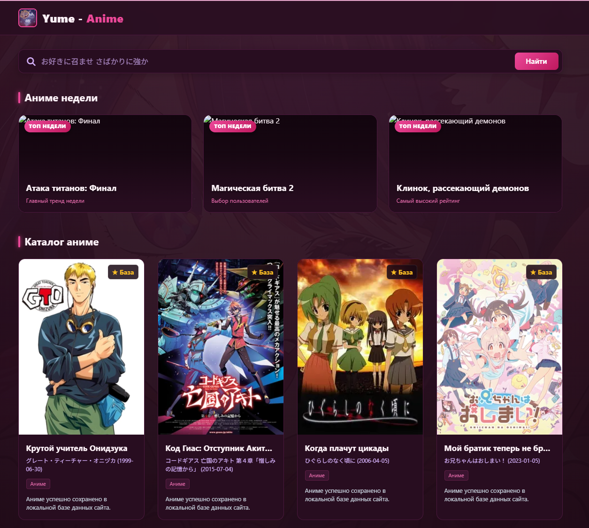

<div align="center">

# 🌸 Yume-Anime

[](https://www.python.org/)
[](https://fastapi.tiangolo.com/)
[](https://www.postgresql.org/)
[](https://www.docker.com/)
[](https://grafana.com/)

**Современный аниме-каталог с русскоязычным интерфейсом, интеллектуальным поиском через Shikimori GraphQL API и полноценным production-grade стеком мониторинга (Prometheus + Grafana + Loki + Grafana Alloy).**

</div>

---

## 📌 О проекте

**Yume-Anime** — это веб-приложение для поиска и просмотра каталога аниме. Проект спроектирован по принципам микросервисной архитектуры в Docker, разделен на статический frontend, мощный бэкенд на FastAPI, реляционную базу данных PostgreSQL и изолированный контур наблюдаемости (Observability).

Особенность проекта — комбинированный **Local-First + External-Sync** поиск: система мгновенно выдает результаты из локальной базы PostgreSQL, параллельно обращаясь к внешнему GraphQL API Shikimori для обогащения данных, скачивания постеров и синхронизации новых тайтлов.




---

## 🚀 Архитектурный стек

| Компонент | Технология | Назначение |
| :--- | :--- | :--- |
| **Frontend** | HTML5, CSS3 Grid, Vanilla JS | Адаптивный пользовательский интерфейс, SPA-роутинг |
| **Backend** | FastAPI (Python 3.14), `psycopg`, `httpx` | REST API, логика поиска, интеграция с Shikimori |
| **Database** | PostgreSQL 18.6 | Хранение метаданных аниме и путей к локальным постерам |
| **Admin UI** | Adminer | Удобное веб-управление базой данных |
| **Web Server** | Nginx | Раздача статики, Reverse Proxy для `/api/` |
| **Metrics** | Prometheus & FastAPI Instrumentator | Сбор и хранение метрик производительности (RPS, Latency) |
| **Logs** | Grafana Alloy & Loki | Безагентный сбор Docker-логов (Alloy) и их централизованное хранение (Loki) |
| **Dashboards**| Grafana | Визуализация метрик и логов в реальном времени |

---

## 🏗️ Структура репозитория

```text
├── anime_photo/                # Локальное хранилище постеров (разделено с Nginx и Backend)
├── db/
│   └── init.sql                # SQL-скрипт инициализации таблицы anime_list
├── DockerFiles/
│   └── Dockerfile_python_backend # Dockerfile для сборки FastAPI-сервиса
├── env_examples/               # Шаблоны конфигурационных файлов (.env)
├── monitoring/
│   ├── alloy-config.alloy      # Конфигурация Grafana Alloy (сбор логов из Docker)
│   ├── loki-config.yaml        # Конфигурация Loki (хранение логов 7 дней)
│   └── prometheus/
│       └── prometheus.yml      # Scrape-конфигурация Prometheus
├── nginx/
│   ├── data/                   # Frontend-файлы (HTML, CSS, ассеты, фоны)
│   └── nginx_configuration/    # Конфиги Nginx (default.conf)
├── python/
│   ├── main.py                 # Основное FastAPI-приложение и эндпоинты
│   ├── shikimori.py            # Асинхронный GraphQL-клиент Shikimori
│   └── images.py               # Модуль параллельной загрузки постеров (.part -> rename)
└── docker-compose.yml          # Главный манифест оркестрации контейнеров

```

## 🌐 Схема взаимодействия сетей

Проект изолирован в трех Docker bridge-сетях для максимальной безопасности:

1. **`frontend_net`**: Связывает Nginx и FastAPI Backend.
2. **`backend_net`**: Изолирует FastAPI Backend, PostgreSQL и Adminer.
3. **`monitor_net`**: Объединяет сервисы мониторинга (Prometheus, Grafana, Alloy, Loki).

---

## ⚙️ Быстрый старт и развертывание

### 1. Подготовка окружения

Перед запуском контейнеров необходимо создать папку `env` в корне проекта и скопировать туда файлы конфигурации из `env_examples/`:

```bash
mkdir -p env
cp env_examples/.env.api.example env/.env.api
cp env_examples/.env.db.example env/.env.db
cp env_examples/.env.grafana.example env/.env.grafana

> ⚠️ **Важно:** Убедитесь, что переменная `DB_PASSWORD` в `.env.api` совпадает с `POSTGRES_PASSWORD` в `.env.db`. В файле `.env.grafana` используйте стандартный формат `KEY=VALUE` без ведущих дефисов.

### 2. Запуск проекта

Соберите и запустите все сервисы в фоновом режиме:

```bash
docker compose up -d --build

```

---

## 📊 Доступные сервисы

После успешного запуска вам будут доступны следующие веб-интерфейсы:

* 🌐 **Веб-сайт (Yume-Anime):** [http://localhost](http://localhost)


* 🗄️ **Adminer (База данных):** [http://localhost:8051](http://localhost:8051) *(Сервер: `postgre_sql`)*


* 📈 **Grafana (Дашборды и логи):** [http://localhost:3000](http://localhost:3000) *(Логин/Пароль из `.env.grafana`)*


* 🔭 **Prometheus (Метрики):** [http://localhost:9090](http://localhost:9090)


* 🧩 **Grafana Alloy (Инспекция сборщика):** [http://localhost:12345](http://localhost:12345)


---

## 🔍 API-Контракты

* `GET /api/random` — Возвращает до 6 случайных аниме из локальной базы (`ORDER BY RANDOM()`).


* `GET /api/search/local?q=<query>` — Мгновенный локальный поиск по полям `name`, `russian`, `japanese` с использованием `ILIKE`.


* `GET /api/search/sync?q=<query>` — Синхронный поиск: локальный поиск $\rightarrow$ GraphQL-запрос к Shikimori $\rightarrow$ параллельное скачивание постеров $\rightarrow$ `UPSERT` в PostgreSQL $\rightarrow$ возврат общего результата.


* `GET /api/anime/{id}` — Получение детальной информации по внутреннему ID аниме.


* `GET /metrics` — Эндпоинт для сбора метрик Prometheus (инструментирован через `prometheus-fastapi-instrumentator`).


---

## 🛠️ Планы по развитию (Roadmap)

* [ ] Реализация полноценной страницы деталей тайтла (жанры, студии, статус, рейтинг).


* [ ] Переход на полноценный шаблон Cache-Aside с TTL для внешних запросов к Shikimori.


* [ ] Добавление пользовательских аккаунтов, системы избранного и истории просмотров.


* [ ] Интеграция онлайн-плеера и каталога источников видео.


* [ ] Полная автоматизация импорта JSON-дашбордов Grafana через механизм provisioning.


---

## 📝 Лицензия

Проект распространяется под лицензией MIT. Подробности смотрите в файле `LICENSE`.


С любовью от **Vmsk_Wivi** 🌸
=======
